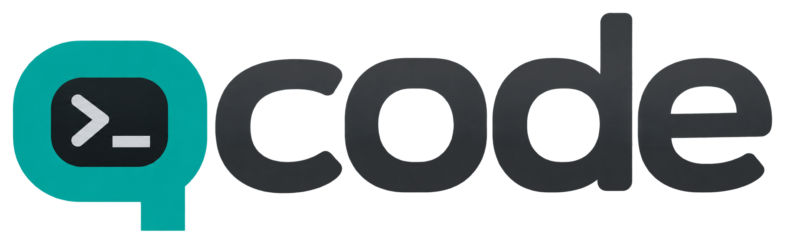
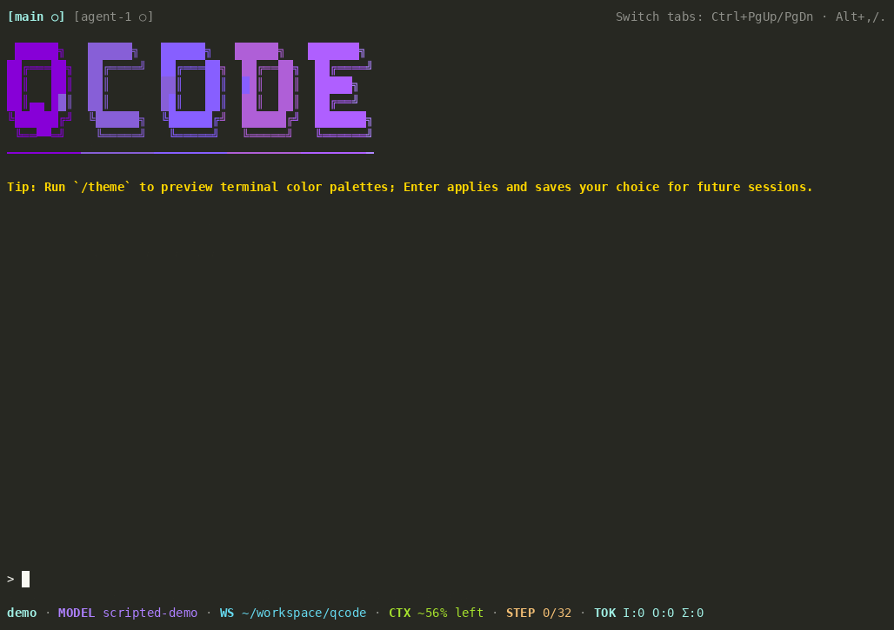

<p align="center">
  <picture>
    <source media="(prefers-color-scheme: dark)" srcset="docs/assets/qcode-dark.png">
    <source media="(prefers-color-scheme: light)" srcset="docs/assets/qcode-light.png">
    
  </picture>
</p>

[](https://go.dev/)
[](LICENSE)
[]()

> Your terminal's second brain — fast, private, and everywhere you are.

qcode is a keyboard-first AI coding assistant that lives in your terminal. One static binary, zero runtime to install, streaming answers, and your choice of model — from a local Ollama to hosted APIs to your ChatGPT subscription.

## 🎬 Demo



## ✨ Why qcode?

### 🪶 Small footprint, stays out of the way
One static binary (~13 MB, `CGO_ENABLED=0`, stdlib networking only). No Electron, no daemon, no Python env to babysit. It starts instantly, streams as it thinks, and keeps your scrollback intact. Details: [Building](docs/build.md).

### 📱 Your terminal, from your phone
Run `/remote` and steer the *same* live agents from a browser — queues, approvals, todo progress included. Pick **Pure Web** on a trusted LAN, **Tailscale** for your tailnet over HTTPS, or open QR login links that expire in minutes. Walk away from your desk without abandoning the run. Details: [Browser control](docs/remote-control.md).

### 💻 Native builds for every machine
Separate static binaries per platform — Linux, macOS, Windows (`amd64`/`arm64`) plus FreeBSD (`amd64`). ARM builds happily run on Pi-class boards and small servers. Self-updates with `qcode update`. Details: [Building](docs/build.md).

### 🔌 Bring any model, switch mid-thought
Ollama for local inference, [Ollama Cloud](docs/providers.md#ollama-cloud) without a local daemon, OpenAI-compatible endpoints, native Gemini, OpenCode Go (Claude, GPT, Grok, Qwen and more), or ChatGPT via OAuth — plus named instances like `[providers.ollama-lab]` for that second server. Swap with `/provider` without restarting; each tab keeps its own model. Details: [Providers](docs/providers.md).

### 🔒 Let it run shell — without letting it roam
Opt-in Linux sandbox (bubblewrap): fresh namespace per command, no network by default, hidden home, read-only root, approved directories only. Keys and configs stay outside the sandbox. Details: [Trust Model](docs/trust-model.md).

### ✅ Ships with a second pair of eyes
`/autoreview` watches `main` and only speaks up when files actually changed — then reviews, fixes, and re-checks in a dedicated `review` tab (`AR` badge). Read-only answers never trigger it; `[skip review]` opts out. Details: [Interface](docs/interface.md).

### And the rest just fades into the background
- **Up to 20 tabs** — one `main`, many helpers, zero context-switching pain.
- **Steer with Enter, queue with Tab** — interrupt gracefully, line up what's next.
- **Plan mode** — look before it leaps; read-only recon, then explicit `act`.
- **Todo panel (`Alt+T`)** — quiet checklist that proves progress happened.
- **It asks before it guesses** — up to 3 sharp questions instead of broad searches.
- **It remembers** — global learning, skills, and MCP servers travel with you.
- **It redacts** — keys and card numbers never make it to disk or screen.
- **It counts** — live context/token meter, themes that match your terminal, sessions you can resume, rename, and pin.

## 🚀 Quick Start

```sh
# Build from source (requires Go 1.23+)
make build
./bin/qcode

# Or grab a release binary, then:
qcode setup   # 2-minute wizard: provider, keys, model
qcode         # start coding
qcode prompt "explain this repository"  # one-shot
```

No setup patience? Take the offline tour: `qcode --demo`. Full flags, env vars, and one-shot mode live in [Command line](docs/cli.md); provider walkthroughs in [Providers](docs/providers.md).

## 📖 Documentation

- [User Manual (PDF)](docs/manual/qcode-user-manual.pdf) - How to use qcode, with example screens for common commands
- [Command line](docs/cli.md) - Startup flags, piped prompts, environment variables, and updates
- [Interface](docs/interface.md) - Terminal UI, slash commands, and navigation
- [Plan mode](docs/plan-mode.md) - Read-only planning and explicit execution handoff
- [Interactive questions](docs/interactive-mode.md) - Per-agent question toggle and terminal workflow
- [Browser control](docs/remote-control.md) - Use the same live session from a phone or browser
- [Skill Plan mode](docs/skillplan.md) - Guided, review-first qcode skill creation
- [Token usage](docs/token-usage.md) - Per-session totals and structured usage events
- [Context usage](docs/context.md) - Remaining capacity, estimates, and automatic compaction
- [Prompt caching](docs/prompt-caching.md) - Provider usage semantics and cache capability evidence
- [Providers](docs/providers.md) - Ollama, Ollama Cloud, OpenAI-compatible, Gemini, OpenCode Go, and ChatGPT setup, plus named provider instances
- [Multi-agent](docs/agents.md) - Concurrent agent tabs and orchestration
- [Skills](docs/skills.md) - Workspace-local instruction bundles, [official release skills](docs/skills/), and authoring guidance
- [Web Tools](docs/web-tools.md) - HTTP fetching and search capabilities
- [Learning](docs/learning.md) - Persistent preferences and procedures
- [Configuration](docs/configuration.md) - Config file locations and options
- [Privacy](docs/privacy.md) - Local redaction, saved sessions, and provider disclosure
- [Trust Model](docs/trust-model.md) - Security and sandbox behavior
- [Building](docs/build.md) - Build instructions and release process
- [Extending Providers](docs/extending-providers.md) - Adding new LLM providers

## 🔧 Configuration

Prefer `qcode setup` over hand-editing files. When you do edit, see [Configuration](docs/configuration.md) for locations, precedence, named instances, MCP servers, and every knob — with [`config.toml.example`](config.toml.example) as the template and `qcode config check` as the validator.

## 🤝 Contributing

Contributions are welcome! Please feel free to submit a Pull Request.

## 📄 License

This project is licensed under the MIT License - see the [LICENSE](LICENSE) file for details.

## 🙏 Acknowledgments

- Inspired by [Pi](https://github.com/earendil-works/pi)
- Built with Go and standard library networking
